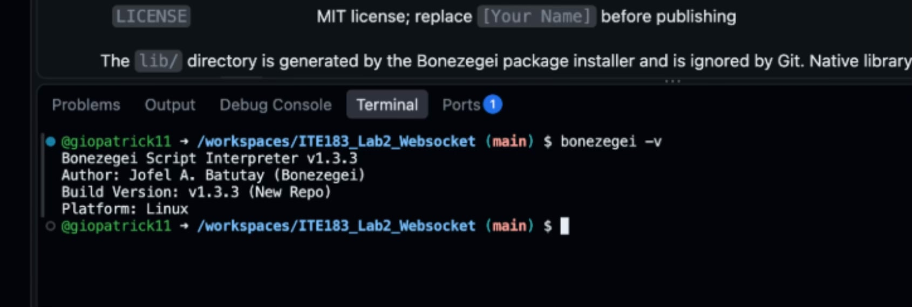
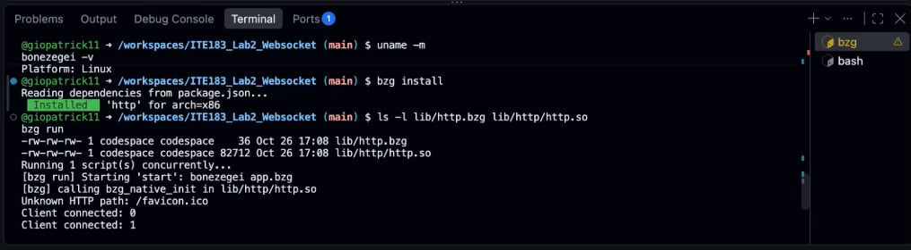
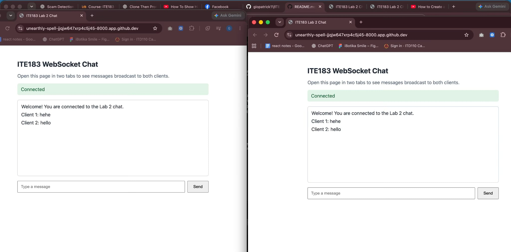
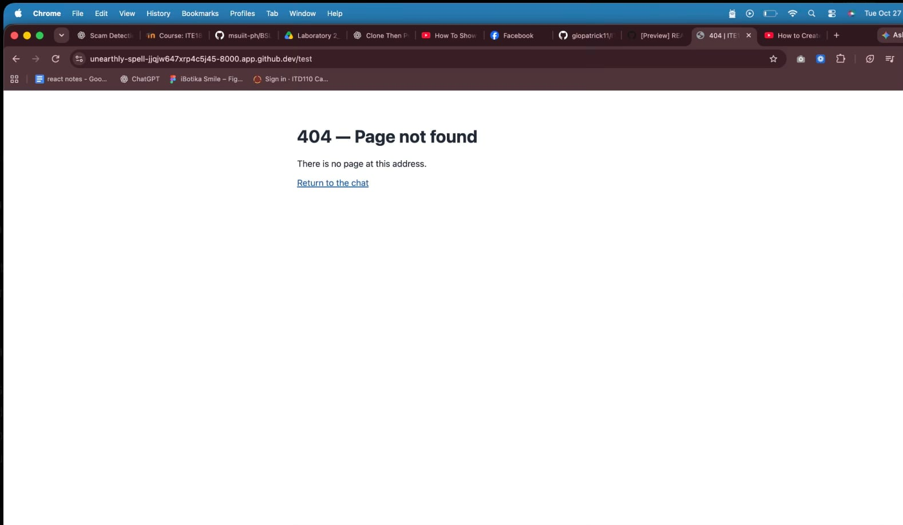
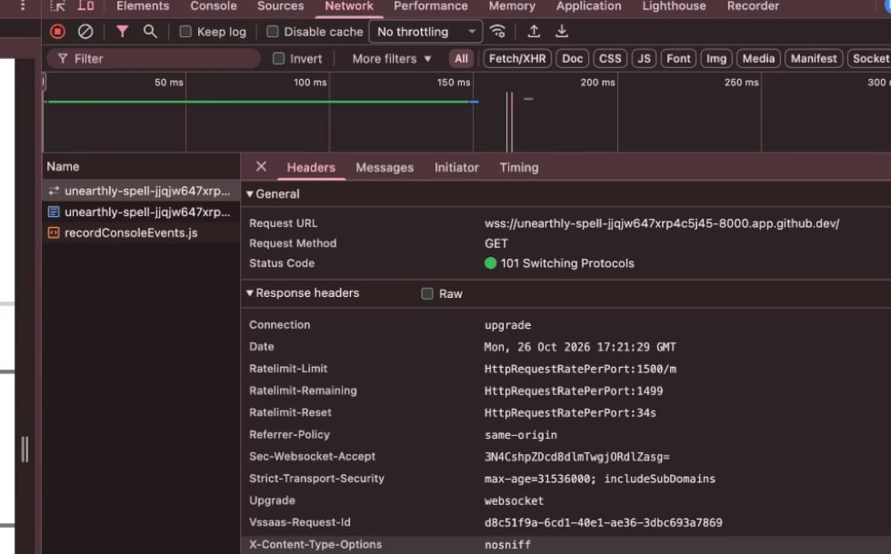

# ITE183 Laboratory 2: WebSocket Server

**Name:** Gio Patrick G. Cimeni<br>
**Course and Section:** ITE183 - IT4D

## Overview

This project implements a real-time, multi-client chat server using Bonezegei Scripting Language (BSL). It serves a browser chat page on port `8000`, handles WebSocket connections, broadcasts messages to all connected clients, and serves a custom page for undefined routes.

## Features

- HTTP route handling for the chat page and custom 404 page
- Browser-based WebSocket chat interface
- Client identification and welcome messages
- Real-time message broadcasting to connected clients
- Connection and disconnection logging
- `ws://` for local HTTP access and `wss://` for HTTPS Codespaces access

## Requirements

- Bonezegei Scripting Language v1.3.3
- Bonezegei package manager (`bzg`)
- Linux or GitHub Codespaces
- A web browser

## Installation

Install Bonezegei in Linux or GitHub Codespaces using the commands in the laboratory guide:

```bash
wget https://github.com/bonezegei/Bonezegei_Scripting_Language/raw/refs/heads/main/Release/Latest/Bonezegei-x86.deb
sudo apt install ./Bonezegei-x86.deb
```

Check the required version, then install this project's `http` dependency from the project root:

```bash
bonezegei -v
bzg install
```

The version output should show `1.3.3`. The dependency installer creates the platform-specific `lib/` files, which are ignored by Git.

## Running the Server

From the project root, run:

```bash
bzg run
```

For local Linux execution, open `http://localhost:8000/`. In GitHub Codespaces, forward port `8000` from the Ports panel and open its forwarded URL. The chat client uses the current page's host and chooses `ws://` or `wss://` according to the page protocol.

## Testing

1. Open the chat URL in two browser windows or tabs.
2. Confirm that both clients connect and receive a welcome message.
3. Send a message from one client and check that it appears in both windows.
4. Send a reply from the second client and check both windows again.
5. Close a client and inspect the terminal for its disconnection log.
6. Open `/test` to display the custom page for an undefined route.
7. Inspect the browser's Network panel for a WebSocket request with status `101 Switching Protocols`.

## Screenshots

These screenshots are also included in the [laboratory report](docs/ITE183_Laboratory_2_Report.pdf).

### Bonezegei Version

`bonezegei -v` reports v1.3.3.



### Dependency Installation and Server Startup

`bzg install` installs the HTTP package, and `bzg run` starts the server with client connection logs.



### Multi-client Broadcasting

Two connected browser windows receive the same `Client 1: hehe` and `Client 2: hello` messages.



### Custom 404 Page

The undefined `/test` route displays the custom missing-page interface.



### WebSocket Handshake

Chrome DevTools shows a `wss://` request with status `101 Switching Protocols`.



## Report and Rubric Evaluation

The full [ITE183 Laboratory 2 report](docs/ITE183_Laboratory_2_Report.pdf) describes the procedure, results, and evidence. The laboratory rubric weights running code and functionality at **70%** and documentation and deliverables at **30%**.

| Criterion | Evidence from this project |
| --- | --- |
| Running code and functionality (70%) | `app.bzg` handles connections, welcome messages, broadcasting, disconnections, page serving, and undefined routes. The screenshots show startup, two-client chat, custom-page rendering, and a successful WebSocket handshake. |
| Documentation and deliverables (30%) | The repository includes `README.md`, `.gitattributes`, an MIT `LICENSE`, the source files, these screenshots, and the laboratory report. |

This is a self-evaluation of the available evidence, not an instructor grade. The custom-page screenshot shows what the browser rendered; it does not prove the HTTP response status. The handler calls `sendResponse(..., "text/html", 404)`, and `curl -i http://localhost:8000/test` can verify the status in a running environment. The screenshots also do not show a disconnection event.

## Project Files

| Path | Purpose |
| --- | --- |
| `app.bzg` | Server routes and WebSocket handlers |
| `package.json` | BSL entry point and `http` dependency |
| `public/index.html` | Browser chat interface |
| `public/404.html` | Custom missing-page content |
| `documentation/` | Selected screenshots used in this README |
| `docs/ITE183_Laboratory_2_Report.pdf` | Full laboratory report |

The original `pictures/` working folder remains ignored by Git. The selected screenshots above are kept in `documentation/` so they display in this README.

## References

- ITE183 Laboratory 2: WebSocket Server laboratory guide
- [Completed reference project](https://github.com/dara1030-debug/ITE183_Lab2_Websocket), used as a guide to the API and file layout

The implementation follows the guide's required structure. Its sample `package.json` has a trailing comma, so this project's manifest uses valid JSON.

## License

MIT License. See [`LICENSE`](LICENSE).
